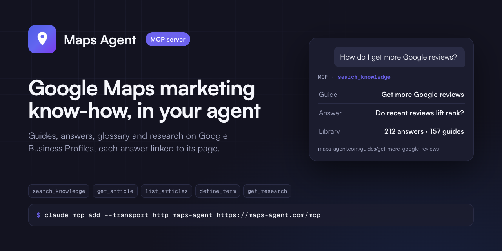

# Maps Agent MCP server

Google Business Profile and Google Maps know-how for AI agents: guides, answers, a glossary and research on reviews,
categories, photos, posts and local rankings. Each answer links to its page on maps-agent.com.

- **Server:** `https://maps-agent.com/mcp` - remote, Streamable HTTP, read-only, no sign-in, no key.
- **MCP Registry name:** `com.maps-agent/knowledge`.

This repository holds the connection files, the plugin and the skill. The server runs at maps-agent.com.

## Tools

| Tool | What it does |
| --- | --- |
| `search_knowledge` | Search guides, answers, research and the glossary; filter by form. |
| `get_article` | One page in full as markdown, with its canonical URL and update date. |
| `list_articles` | What is published, by form and topic. |
| `define_term` | A local SEO term in plain words. |
| `get_research` | One study with its method, sample and findings. |

## Connect

| Client | How |
| --- | --- |
| Claude, Claude Desktop | Settings - Connectors - Add custom connector - `https://maps-agent.com/mcp` |
| Claude Code | `claude mcp add --transport http maps-agent https://maps-agent.com/mcp` |
| Claude Code, plugin | `/plugin install maps-agent --marketplace maps-agent/mcp` |
| ChatGPT | Settings - Apps - developer mode - Create - URL `https://maps-agent.com/mcp`, no authentication |
| Cursor | [`.mcp.json`](.mcp.json) in your project or `~/.cursor/mcp.json` |
| VS Code | `code --add-mcp '{"name":"maps-agent","type":"http","url":"https://maps-agent.com/mcp"}'` |
| Codex | `codex mcp add maps-agent --url https://maps-agent.com/mcp` |
| Gemini CLI | `gemini extensions install https://github.com/maps-agent/mcp` |

## Example questions

- How do I get more Google reviews for my local business?
- What is a Google Business Profile primary category and how should I choose it?
- What does "proximity" mean in Google Maps rankings?

## Terms

Terms: https://maps-agent.com/terms. Privacy: https://maps-agent.com/privacy. Contact: hello@maps-agent.com.
The files in this repository are MIT-licensed; the content the service returns is not covered by that licence.
