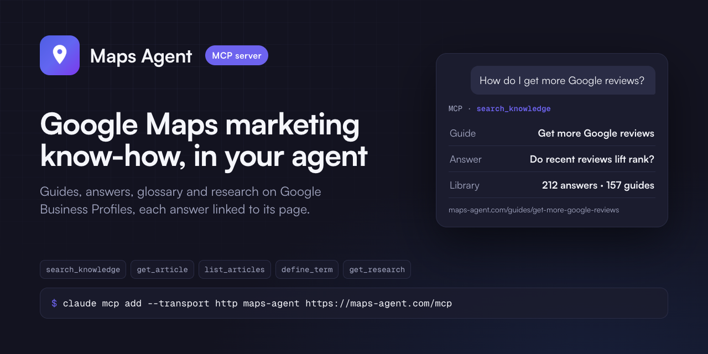

# Maps Agent MCP



Find guides, studies and definitions about Google Business Profile and local SEO. Use sources on reviews, categories and Google Maps rankings, and request a public profile audit where available.

- **MCP** `https://maps-agent.com/mcp` (Streamable HTTP). No sign-in or API key. Audit and feedback tools can submit data.
- **MCP Registry** `com.maps-agent/knowledge` · `1.3.0`
- **Skills** [`maps-agent`](skills/maps-agent/SKILL.md)

## Tools

| Tool | Purpose |
| --- | --- |
| `search` | Search Maps Agent knowledge |
| `fetch` | Read a page in full |
| `list_articles` | List published pages |
| `define_term` | Define a local SEO term |
| `get_research` | Read a study with its method |
| `find_categories` | Find Google Business Profile categories |
| `get_changes` | What Google changed |
| `get_plans` | Maps Agent plans and prices |
| `audit_business` | Audit a business on Google Maps |
| `send_feedback` | Send Maps Agent feedback |

## One-click installation

[Claude](https://claude.ai/customize/connectors?modal=add-custom-connector&connectorName=Maps%20Agent&connectorUrl=https%3A%2F%2Fmaps-agent.com%2Fmcp) · [Cursor](https://cursor.com/install-mcp?name=maps-agent&config=eyJ1cmwiOiJodHRwczovL21hcHMtYWdlbnQuY29tL21jcCJ9) · [VS Code](https://vscode.dev/redirect?url=vscode%3Amcp%2Finstall%3F%257B%2522name%2522%253A%2522maps-agent%2522%252C%2522type%2522%253A%2522http%2522%252C%2522url%2522%253A%2522https%253A%252F%252Fmaps-agent.com%252Fmcp%2522%257D) · [Kiro](https://kiro.dev/launch/mcp/add?name=maps-agent&config=%7B%22url%22%3A%22https%3A%2F%2Fmaps-agent.com%2Fmcp%22%7D) · [Goose](goose://extension?url=https%3A%2F%2Fmaps-agent.com%2Fmcp&type=streamable_http&timeout=300&id=maps-agent&name=Maps%20Agent&description=Find%20Google%20Business%20Profile%20guides%2C%20local%20SEO%20research%20and%20practical%20answers.) · [Qoder](qoder://aicoding.aicoding-deeplink/mcp/add?name=maps-agent&config=JTdCJTIydXJsJTIyJTNBJTIyaHR0cHMlM0ElMkYlMkZtYXBzLWFnZW50LmNvbSUyRm1jcCUyMiU3RA%3D%3D) · [Replit](https://replit.com/integrations?mcp=eyJkaXNwbGF5TmFtZSI6Ik1hcHMgQWdlbnQiLCJiYXNlVXJsIjoiaHR0cHM6Ly9tYXBzLWFnZW50LmNvbS9tY3AifQ%3D%3D) · [LM Studio](lmstudio://add_mcp?name=maps-agent&config=eyJ1cmwiOiJodHRwczovL21hcHMtYWdlbnQuY29tL21jcCJ9)

If GitHub hides the application links, paste the corresponding link into your browser:

- Goose - `goose://extension?url=https%3A%2F%2Fmaps-agent.com%2Fmcp&type=streamable_http&timeout=300&id=maps-agent&name=Maps%20Agent&description=Find%20Google%20Business%20Profile%20guides%2C%20local%20SEO%20research%20and%20practical%20answers.`
- Qoder - `qoder://aicoding.aicoding-deeplink/mcp/add?name=maps-agent&config=JTdCJTIydXJsJTIyJTNBJTIyaHR0cHMlM0ElMkYlMkZtYXBzLWFnZW50LmNvbSUyRm1jcCUyMiU3RA%3D%3D`
- LM Studio - `lmstudio://add_mcp?name=maps-agent&config=eyJ1cmwiOiJodHRwczovL21hcHMtYWdlbnQuY29tL21jcCJ9`

[Install link data](install-links.json)

```sh
claude mcp add --transport http maps-agent https://maps-agent.com/mcp
claude plugin install maps-agent --marketplace maps-agent/mcp
codex mcp add maps-agent --url https://maps-agent.com/mcp
agy plugin install https://github.com/maps-agent/mcp/tree/main/antigravity/maps-agent
gemini extensions install https://github.com/maps-agent/mcp
```

## Package formats

| Client | File |
| --- | --- |
| Claude | [marketplace.json](.claude-plugin/marketplace.json) |
| ChatGPT / Codex | [plugin.json](openai/maps-agent/plugin.json) · [marketplace.json](.agents/plugins/marketplace.json) |
| Antigravity | [plugin.json](antigravity/maps-agent/plugin.json) |
| Gemini CLI | [gemini-extension.json](gemini-extension.json) · [Skills](skills/) |
| Cursor | [plugin.json](.cursor-plugin/plugin.json) |
| Kiro | [POWER.md](kiro/maps-agent/POWER.md) |
| Kilo | [MCP.yaml](MCP.yaml) |
| Cline | [entry.json](entry.json) · [llms-install.md](llms-install.md) |
| Devin | [plugin.json](devin/maps-agent/.devin-plugin/plugin.json) |
| Agent Plugins | [plugin.json](plugin.json) |
| MCP Registry | [server.json](server.json) |

## Example questions

- How do I get more Google reviews for my local business?
- How should I choose my Google Business Profile primary category?
- What does proximity mean in Google Maps rankings?

## Terms and privacy

- [Terms](https://maps-agent.com/terms)
- [Privacy](https://maps-agent.com/privacy)
- Support: hello@maps-agent.com
- [MIT](LICENSE) · [Changelog](CHANGELOG.md)
